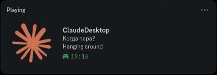

# claude-desktop-presence

**Карточка Discord для Claude Desktop на Linux.** Показывает, какой чат открыт и чем Claude занят, а вместо скучного «думает» пишет пасхалки из песен, игр, книг и про самого Claude с его талисманом Clawd.

   

*[English version](README.en.md)*



---

> ### Прочитайте до установки
>
> **Версия 0.1.2 «Sandevistan».** [Что нового](https://github.com/tomon-one/claude-desktop-presence/releases).
>
> | | |
> |---|---|
> | проверено каждый день | Fedora 44, Hyprland 0.56, Claude Desktop (неофициальная сборка для Linux 2.42304), Discord 1.0.162 |
> | проверено вживую | ожидание разрешения на команду (замок на значке, 9 октября 2026), сжатие контекста, фоновые агенты, ошибка |
> | только написано | пути к сокету Discord из Flatpak, Snap и Vesktop |
> | не поддерживается | macOS, Windows, Claude Code в терминале без Desktop |
>
> **Код писал ИИ:** Claude, по задачам автора и с его правками. [Подробнее](#написано-вместе-с-ии).
>
> Скрипт читает внутренние файлы Claude Desktop и Claude Code. Это не публичный интерфейс, и обновление может их поменять.

---

[Зачем это](#зачем-это) · [Установка](#установка) · [Настройка](#настройка) · [Пасхалки](#пасхалки) · [Приватность](#приватность) · [Как устроено](#как-устроено) · [Обновление и удаление](#обновление-и-удаление)

---

## Зачем это

Сам по себе Discord Claude не показывает. На Linux его можно добавить вручную как игру, но карточка будет пустой, с вопросительным знаком. Эта программа делает её живой:

- **первая строка:** открытый чат, а если чат не выбран, «Главное меню»;
- **вторая строка:** что делает Claude: думает, правит файлы, задал вопрос, ждёт разрешения, ответил, ждёт тебя, гоняет фоновых агентов, упёрся в ошибку или сжимает контекст. У каждого состояния свои фразы, большая часть из них пасхалки;
- **время:** сколько открыт Claude Desktop.

Модели, токенов и лимитов здесь нет специально. Если нужны они, есть [rar-file/claude-rpc](https://github.com/rar-file/claude-rpc) и [BrunoJurkovic/claude-code-discord-status](https://github.com/BrunoJurkovic/claude-code-discord-status), но они для Claude Code, а не для Desktop.

Это один файл на Python без сторонних библиотек и служба systemd. В интернет не ходит, файлы Claude только читает.

**Чего не умеет:** работает только с Claude Desktop; у облачных чатов нет состояния, только название «Облачная сессия»; сжатие контекста видно только с хуком (его ставит установщик).

---

## Установка

Нужны Linux с systemd, Python 3.11 или новее, Claude Desktop и Discord (обычный, Flatpak, Snap или Vesktop).

1. Создай приложение на [discord.com/developers/applications](https://discord.com/developers/applications). Его имя Discord покажет после «Играет в». Имя «Claude» занято, подойдёт, например, «ClaudeDesktop».
2. В разделе Rich Presence → Art Assets загрузи картинку 1024×1024 с ключом `claude`. Скопируй Application ID со страницы General Information.
3. Скачай и установи:
   ```bash
   git clone https://github.com/tomon-one/claude-desktop-presence ~/claude-desktop-presence
   cd ~/claude-desktop-presence
   ./install.sh
   ```
4. Впиши Application ID в `~/.config/claude-desktop-presence/config.toml` и запусти службу:
   ```bash
   systemctl --user enable --now claude-desktop-presence
   ```
5. Если раньше добавлял `claude` в Discord вручную, удали его в настройках Discord, раздел «Зарегистрированные игры», иначе карточек будет две.

Установщик добавляет в `~/.claude/settings.json` хук `PreCompact`: пока Claude сжимает контекст, он ничего не пишет в журнал, и без хука это состояние не увидеть. Хук только оставляет пустой файл-метку. Без него: `./install.sh --no-hook`, по-английски: `./install.sh --lang en`.

---

## Настройка

Всё лежит в `~/.config/claude-desktop-presence/`: `config.toml` с настройками, `words.txt` с фразами (перечитывается на лету) и `hide.txt` со скрытыми чатами.

Необязательное в `config.toml`:

| настройка | что делает |
|---|---|
| `status_display = "state"` | в списке участников сервера под ником будет фраза, а не имя приложения |
| `state_icons = true` | значок состояния в углу картинки. Значки лежат в [docs/icons](docs/icons), загрузи их в Art Assets с ключами по именам файлов |
| `[labels]` | подсказка при наведении на значок: что Claude делает, простыми словами (русские ставит установщик) |
| `buttons` | до двух кнопок со ссылками, их видят другие, но не ты |

После правки `config.toml`: `systemctl --user restart claude-desktop-presence`. Лог: `journalctl --user -u claude-desktop-presence -f`.

---

## Пасхалки

Фразы лежат в `words.txt` по разделам, по одной в строке. Условие пишется после `@`, например `Wake up, Samurai @дольше 30`. Фраза меняется раз в 30 секунд и при каждой смене состояния.

| условие | когда показывается |
|---|---|
| без условия | всегда, вперемешку с остальными |
| `@ночь` | с 23:00 до 5:00, вперемешку с остальными |
| `@03:45` | только в эту минуту, вместо остальных |
| `@дольше 30` | состояние длится больше 30 минут. Чередуется с обычными фразами, из нескольких порогов берётся больший |
| `@утро` | первое ожидание за утро, с 5 до 12. Чередуется с обычными фразами |
| `@шанс 25` | с вероятностью 25 % при входе в состояние. Чередуется с обычными фразами |
| `@сессия 8` | чат создан или сжат (`/compact`) больше 8 часов назад. Чередуется с обычными фразами |
| `@запуск` | только в разделе `[событие]`: первая минута после запуска Claude Desktop |
| `@переключение 15` | только в разделе `[событие]`: с вероятностью 15 % при смене чата, на минуту |

Ниже набор по умолчанию, `words/ru.txt`. Английская версия лежит в `words/en.txt`. Названия разделов и условий понимаются на обоих языках.

**Думает**

| фраза | когда | отсылка |
|---|---|---|
| Думает | всегда | |
| Генерирует | всегда | |
| Seems hard | всегда | The Cardigans, песня «Seems Hard» (альбом Emmerdale) |
| I figured out | всегда | The Cardigans, «I Figured Out», би-сайд сингла «Black Letter Day» (сборник The Other Side of the Moon) |
| Делит на части | всегда | The Cardigans, песня «Great Divide» (First Band on the Moon) |
| Становится человеком | всегда | игра Detroit: Become Human |
| Нестабильность ПО ▲ | всегда | Detroit: Become Human, индикатор программы Коннора |
| Ищет свет во тьме | всегда | игра The Last of Us, девиз Цикад |
| Копает прямо вниз | всегда | Minecraft, главное правило «не копай прямо вниз» |
| Ищет бензин | всегда | игра Days Gone, вечно пустой бак байка |
| Long gone before daylight | ночью | The Cardigans, альбом «Long Gone Before Daylight» |
| 03:45: No Sleep | в 03:45 | The Cardigans, песня «03:45: No Sleep» (Long Gone Before Daylight) |
| Overloaded | дольше 5 минут | The Cardigans, песня «Overload» (Super Extra Gravity) |
| Киберпсихоз подкрадывается | дольше 15 минут | игра Cyberpunk 2077 |
| Clauding | всегда | Claude Code, слово спиннера |
| Думает о мосте Золотые Ворота | всегда | Golden Gate Claude, эксперимент Anthropic 2024 года |
| Clawd едет на облаке | всегда | Clawd, официальная сценка на облаке |
| Ultrathink | дольше 10 минут | Claude Code, ключевое слово для самого глубокого размышления |
| Токены не резиновые | сессия дольше 8 часов | |
| To the Depths With You | дольше 15 минут | аниме Cyberpunk: Edgerunners 2, название 7-й серии |
| Один мозг на двоих | всегда | аниме Cyberpunk: Edgerunners 2, 4-я серия, Капри: «у нас с тобой один мозг на двоих» |
| Ищет сосуд | всегда | аниме Cyberpunk: Edgerunners 2, 4-я серия, Капри искала сосуд для себя |
| Ходит кругами, как в доме Кёко | дольше 20 минут | аниме Cyberpunk: Edgerunners 2, 3-я серия, Роман и Ди всё время возвращаются в одно место |
| Роман ищет кадр | всегда | аниме Cyberpunk: Edgerunners 2, Роман снимает всё подряд |
| Ди ищет лазейку в Арасаку | всегда | аниме Cyberpunk: Edgerunners 2, 2-я серия, взлом Арасаки через подрядчиков |
| Ищет Альт за Заслоном | дольше 10 минут | Cyberpunk 2077, Альт Каннингем за Чёрным заслоном |
| Перематывает брейнданс | всегда | Cyberpunk 2077, монтаж брейнданса с Джуди |
| Джуди монтирует брейнданс | всегда | Cyberpunk 2077, Джуди Альварес |

**Правит файлы**

| фраза | когда | отсылка |
|---|---|---|
| Ведёт расследование, как Ковач | всегда | Ричард Морган, роман «Видоизменённый углерод», Такеси Ковач |
| Push B non stop | всегда | Counter-Strike 2, раш на точку B |
| Combobulating | всегда | Claude Code, слово спиннера |
| Clawd печатает на ноутбуке | всегда | Clawd, официальная анимация с ноутбуком |
| Мне становится весело | всегда | аниме Cyberpunk: Edgerunners 2, 3-я серия, Капри в теле Ди |
| Сам себе ставит импланты | всегда | аниме Cyberpunk: Edgerunners 2, 2-я серия, Авида о Талии |
| Снимает на 35 мм | всегда | аниме Cyberpunk: Edgerunners 2, 1-я серия, плёнка — награда Романа от Сала |
| Тактическая диверсия | всегда | аниме Cyberpunk: Edgerunners 2, 2-я серия, план Ди: Роман кричит «Хелио» |
| REC ● | всегда | аниме Cyberpunk: Edgerunners 2, камера Романа |
| Ди взламывает Арасаку | всегда | аниме Cyberpunk: Edgerunners 2, 2-я серия, «может, хакнем Арасаку?» |
| Мешуга ищет ячейку | всегда | аниме Cyberpunk: Edgerunners 2, 1-я серия, налёт на склад |
| Талия ставит новый хром | всегда | аниме Cyberpunk: Edgerunners 2, 2-я серия |
| Роман снимает, Ди прикрывает | всегда | аниме Cyberpunk: Edgerunners 2, 2-я серия |
| Чинит хром у Виктора | всегда | Cyberpunk 2077, рипердок Виктор Вектор |
| Керри репетирует с Samurai | ночью | Cyberpunk 2077, Керри Евродин |
| Панам чинит «Василиска» | всегда | Cyberpunk 2077, Панам Палмер и Альдекальдо |
| Ривер сверяет дело | всегда | Cyberpunk 2077, детектив Ривер Уорд |

**Задал вопрос с вариантами**

| фраза | когда | отсылка |
|---|---|---|
| Красная или синяя таблетка? | всегда | фильм «Матрица» |
| Нужно уточнить | всегда | |
| Clawd смотрит то влево, то вправо | всегда | Clawd, анимация взгляда по сторонам |
| Strictly Reserved For You | всегда | аниме Cyberpunk: Edgerunners 2, название 9-й серии |
| Так докажи мне это | всегда | аниме Cyberpunk: Edgerunners 2, 1-я серия, Талия Роману |
| Анестезию хочешь или пофиг? | всегда | аниме Cyberpunk: Edgerunners 2, 1-я серия, Мальстрём Роману |
| Сидит с Джонни на крыше | дольше 10 минут | Cyberpunk 2077, выбор концовки |
| Сойка или Рид? | всегда | Cyberpunk 2077: Phantom Liberty |

**Ждёт разрешения на команду**

| фраза | когда | отсылка |
|---|---|---|
| Do you believe? | всегда | The Cardigans, песня «Do You Believe» (Gran Turismo) |
| If there is a chance | всегда | The Cardigans, песня «If There Is a Chance» (Long Gone Before Daylight) |
| Просит дроп | всегда | Counter-Strike 2, просьба скинуть оружие |
| Ждёт приказа | всегда | Detroit: Become Human, андроиды ждут указаний |
| Do you want to proceed? | всегда | Claude Code, текст запроса разрешения |
| Clawd машет лапкой | всегда | Clawd, официальная анимация «машет» |
| Похоже на ловушку. Клюну | всегда | аниме Cyberpunk: Edgerunners 2, 2-я серия, Ди у здания Кёко |
| Проверяет покрытие Траума Тим | всегда | аниме Cyberpunk: Edgerunners 2, 1-я серия, Макс-Так перед штурмом |
| Усиливает лёд на всякий случай | всегда | аниме Cyberpunk: Edgerunners 2, 2-я серия, Ди |
| Уик снова с Лексингтоном | всегда | аниме Cyberpunk: Edgerunners 2, 1-я серия, Уик снова берёт в руки Лексингтон |
| Талия: «Готова начинать» | всегда | аниме Cyberpunk: Edgerunners 2, 2-я серия, Мальстрём |
| Мальстрём берёт заказ | всегда | аниме Cyberpunk: Edgerunners 2, банда Талии |
| Ди просит у Капри разрешения | с вероятностью 15 % | аниме Cyberpunk: Edgerunners 2, Ди и Капри |
| Ти-Баг ломает лёд | всегда | Cyberpunk 2077, налёт на Конпеки-Плазу |
| Сойка на связи | всегда | Cyberpunk 2077: Phantom Liberty |
| Мередит Стаут одобряет заказ | всегда | Cyberpunk 2077, Мередит Стаут из Милитеха |
| Смэшер у двери | с вероятностью 15 % | Cyberpunk 2077, Адам Смэшер |

**Только что ответил** (30 секунд после ответа)

| фраза | когда | отсылка |
|---|---|---|
| Готово | всегда | |
| Breathtaking | с вероятностью 25 % | Киану Ривз на E3 2019: «You're breathtaking!» |
| You're absolutely right! | всегда | главный мем про Claude |
| Clawd пляшет | всегда | Clawd, официальный танец |
| Крутое вышло видео | всегда | аниме Cyberpunk: Edgerunners 2, 2-я серия, Талия о съёмке Романа |
| Дважды спасать не буду | с вероятностью 25 % | аниме Cyberpunk: Edgerunners 2, 1-я серия, Ди Роману |
| Ноль сомнений | всегда | аниме Cyberpunk: Edgerunners 2, 9-я серия, ответ Ди Талии |
| I'm still alive, aren't I? | с вероятностью 20 % | аниме Cyberpunk: Edgerunners 2, Талия |
| Кёко: «Я гений!» | с вероятностью 25 % | аниме Cyberpunk: Edgerunners 2, 3-я серия, флешбек Кёко |
| Сал: «Двести» | с вероятностью 25 % | аниме Cyberpunk: Edgerunners 2, 1-я серия, Сал платит Роману за съёмку |
| Preem | всегда | Cyberpunk 2077, сленг: отлично |
| Delta | с вероятностью 20 % | Cyberpunk 2077, сленг: свалить по-быстрому |

**Ждёт**

| фраза | когда | отсылка |
|---|---|---|
| Ждёт ответа | всегда | |
| Hanging around | всегда | The Cardigans, песня «Hanging Around» (Gran Turismo) |
| Never fade away | всегда | Cyberpunk 2077, песня SAMURAI «Never Fade Away» (и кавер из саундтрека, поёт Ольга Янковская) |
| Ты здесь? Подай знак | всегда | игра Phasmophobia, вопрос к призраку |
| Отель «Хендрикс» ждёт гостей | всегда | «Видоизменённый углерод», отель с ИИ |
| Night City | ночью | Cyberpunk 2077, Найт-Сити |
| Хочет на Луну | ночью | аниме Cyberpunk: Edgerunners, мечта Люси |
| Ждёт 5:08, ничего не нажимая | в 05:08 | Cyberpunk 2077, секретная концовка |
| Wake up, Samurai | дольше 30 минут | Cyberpunk 2077, Джонни Сильверхенд |
| Ждёт, как Вайс-Сити ждёт GTA VI | дольше часа | GTA VI, возвращение в Вайс-Сити |
| Rise & shine | первое ожидание за утро | The Cardigans, песня «Rise & Shine» (Emmerdale) |
| Застрял в Маунт-Мун | всегда | стрим Claude Plays Pokémon |
| Clawd качается в зале | всегда | Clawd, ролик с гантелями |
| Кэш остыл | дольше 75 минут | Claude Code: после 75 минут простоя предлагает /clear |
| Last Chance for a Slow Dance | дольше 45 минут | аниме Cyberpunk: Edgerunners 2, название 1-й серии |
| Give Me Another Day | дольше 20 минут | аниме Cyberpunk: Edgerunners 2, название 2-й серии |
| Хватай камеру и дуй сюда | всегда | аниме Cyberpunk: Edgerunners 2, 2-я серия, Талия звонит Роману |
| Ди-кун проснулся? | первое ожидание за утро | аниме Cyberpunk: Edgerunners 2, 2-я серия, отец Романа |
| Ты же меня видишь? Я знаю, что видишь | дольше 10 минут | аниме Cyberpunk: Edgerunners 2, Капри |
| Then we flatline together. | ночью | аниме Cyberpunk: Edgerunners 2 |
| Батарейка сдохла | дольше 90 минут | аниме Cyberpunk: Edgerunners 2, 2-я серия, камера Романа |
| Пятьдесят дней? Я так долго спал? | дольше двух часов | аниме Cyberpunk: Edgerunners 2, 1-я серия, Кинг очнулся в клинике |
| we'll see each other again. | сессия дольше 8 часов | аниме Cyberpunk: Edgerunners 2 |
| ВЫЗОВ: АВИДА | дольше 15 минут | аниме Cyberpunk: Edgerunners 2, 1-я серия, звонок Кингу |
| Сал ждёт плёнку | всегда | аниме Cyberpunk: Edgerunners 2, 1-я серия, заказ Сала |
| Роман ждёт, пока Ди проснётся | всегда | аниме Cyberpunk: Edgerunners 2, 2-я серия, Ди очнулся у Романа дома |
| Хелио так и не вышел на связь | дольше 30 минут | аниме Cyberpunk: Edgerunners 2, 1-я серия |
| Алам собирает друзей | всегда | аниме Cyberpunk: Edgerunners 2, 5-я серия |
| Слушает HKGN 102.0 FM | всегда | Cyberpunk 2077, обновление 2.5, радио с треками Edgerunners |
| Ждёт звонка от Декса | дольше 15 минут | Cyberpunk 2077, фиксер Декстер Дешон |
| Мисти раскладывает таро | ночью | Cyberpunk 2077, Мисти и арканы таро |
| Джеки ждёт в «Посмертии» | ночью | Cyberpunk 2077, Джеки Уэллс и бар наёмников |
| Роуг не торопит | дольше 15 минут | Cyberpunk 2077, фиксер Роуг |
| Вакако ждёт отчёта | всегда | Cyberpunk 2077, фиксер Вакако |

**Работают фоновые агенты** (ход окончен, но агенты или workflow ещё работают)

| фраза | когда | отсылка |
|---|---|---|
| Размножается, как агент Смит | всегда | фильм «Матрица», агент Смит |
| Запустил демонов | всегда | Cyberpunk 2077, демоны нетраннеров; заодно так в Linux зовут фоновые процессы |
| Пробуждает андроидов | всегда | Detroit: Become Human, Маркус |
| Раскидал тиммейтов по точкам | всегда | Counter-Strike 2 |
| Разделились, ищут призрака | всегда | игра Phasmophobia |
| Claude, Claude и ещё Claude | всегда | субагенты тоже Claude |
| Clawd машет флагом | всегда | Clawd, ролик с флагом |
| 0+2=1 | всегда | аниме Cyberpunk: Edgerunners 2, название 3-й серии |
| Он, она, они, мы… | всегда | аниме Cyberpunk: Edgerunners 2, 4-я серия, Капри |
| Одной деки тут не хватит | всегда | аниме Cyberpunk: Edgerunners 2, Ди Роману |
| Устроили убежище «Тим-Ди» | всегда | аниме Cyberpunk: Edgerunners 2, Талия |
| Kang Tao в деле | всегда | аниме Cyberpunk: Edgerunners 2, бойцы Kang Tao у Авиды |
| Оми собирает команду | всегда | аниме Cyberpunk: Edgerunners 2, Оми |
| Тигриные Когти ищут Талию | всегда | аниме Cyberpunk: Edgerunners 2, 2-я серия |
| Деламейн и его ядра | всегда | Cyberpunk 2077, Деламейн разделился на ядра |
| Вудуисты ломают сеть | всегда | Cyberpunk 2077, Вудуисты и Пласид |

**Чат не выбран**

| фраза | когда | отсылка |
|---|---|---|
| Сидит в лобби | всегда | |
| Press any key | всегда | |
| Ждёт второго игрока | всегда | |
| Бродит по Найт-Сити | ночью | Cyberpunk 2077 |
| Welcome to Claude Code! | всегда | Claude Code, приветствие |
| Clawd гоняет мяч | всегда | Clawd на стартовом экране Claude Code летом 2026 |
| Then Everyone Went Home | всегда | аниме Cyberpunk: Edgerunners 2, название 10-й серии |
| Кино уже мертво | всегда | аниме Cyberpunk: Edgerunners 2, 1-я серия, Роман |
| Смотрит Burst Panic | ночью | аниме Cyberpunk: Edgerunners 2, 1-я серия, фильм «Burst Panic: The Big Crash» |
| Роман выбирает фильм на вечер | всегда | аниме Cyberpunk: Edgerunners 2, 1-я серия |
| Едет на Деламейне | всегда | Cyberpunk 2077, такси с ИИ |
| Гуляет по Догтауну | ночью | Cyberpunk 2077: Phantom Liberty |
| Курт Хэнсен принимает в Догтауне | ночью | Cyberpunk 2077: Phantom Liberty |

**Событие** (на минуту поверх любого состояния)

| фраза | когда | отсылка |
|---|---|---|
| Ready or not? | первая минута после запуска Claude Desktop | Cascada, песня «Ready or Not» (Evacuate the Dancefloor), и игра Ready or Not |
| Ready or not? | с вероятностью 15 % при смене чата | то же |
| Clawd играет на гитаре | первая минута после запуска Claude Desktop | Clawd на стриме Claude FM и в ultracode |
| Я нашла тебя | с вероятностью 10 % при смене чата | аниме Cyberpunk: Edgerunners 2, Капри |
| Траума Тим уже выехала | с вероятностью 20 % при смене чата | аниме Cyberpunk: Edgerunners 2, 1-я серия, платиновая страховка |
| Мегабашня H10 | первая минута после запуска Claude Desktop | Cyberpunk 2077, дом Ви |

**Ошибка**

| фраза | когда | отсылка |
|---|---|---|
| Чёрный день | всегда | The Cardigans, песня «Black Letter Day» (Emmerdale) |
| Wasted | всегда | серия GTA, экран смерти |
| Never Recover | всегда | The Cardigans, песня «Never Recover» (First Band on the Moon) |
| 529 Overloaded | всегда | ошибка API Claude при перегрузке |
| Clawd-детектив ищет баг | всегда | Clawd, официальная сценка детектива |
| Everything Hate | всегда | аниме Cyberpunk: Edgerunners 2, название 6-й серии |
| НЕТ ДОСТУПА. ОБЪЕКТ ИЗЪЯТ | всегда | аниме Cyberpunk: Edgerunners 2, 1-я серия, экран в клинике |
| Нейтрализация киберпсиха | всегда | аниме Cyberpunk: Edgerunners 2, 1-я серия, Макс-Так |
| Арасака сдаёт позиции | всегда | аниме Cyberpunk: Edgerunners 2, 1-я серия, Сал |
| Проект закрыли | всегда | аниме Cyberpunk: Edgerunners 2, сотрудник Арасаки |
| Мешуга: «Ты сорвался» | всегда | аниме Cyberpunk: Edgerunners 2, 1-я серия, Мешуга Мигелю |
| Макс-Так в пути | всегда | аниме Cyberpunk: Edgerunners 2, 1-я серия |
| Реликвия сбоит | всегда | Cyberpunk 2077, сбой Реликвии |
| Flatlined | с вероятностью 25 % | Cyberpunk 2077, сленг: умер |
| Смэшер нашёл нас | с вероятностью 20 % | Cyberpunk 2077, Адам Смэшер |
| Эвелин не отвечает | всегда | Cyberpunk 2077, Эвелин Паркер |

**Сжимает контекст**

| фраза | когда | отсылка |
|---|---|---|
| Сжимается, но не сдаётся | всегда | The Cardigans, «Never Recover» наоборот |
| Новая оболочка, стек цел | всегда | «Видоизменённый углерод»: тело меняется, сознание в стеке остаётся |
| Эко-раунд, копит на AWP | всегда | Counter-Strike 2 |
| Erase/Rewind | всегда | The Cardigans, песня «Erase/Rewind» (Gran Turismo) |
| Compacting conversation | всегда | Claude Code, текст во время сжатия |
| Clawd ходит боком | всегда | Clawd, официальная анимация загрузки |
| Someone That I Used To Know | всегда | аниме Cyberpunk: Edgerunners 2, название 4-й серии |
| Fades (Pass the Distance) | всегда | аниме Cyberpunk: Edgerunners 2, название 5-й серии |
| Мне ничего не снилось | всегда | аниме Cyberpunk: Edgerunners 2, 4-я серия, Ди |
| Переписал идентификатор | всегда | аниме Cyberpunk: Edgerunners 2, 2-я серия, Уик отключает Талии GPS |
| I'll never grow old. | всегда | аниме Cyberpunk: Edgerunners 2, Талия |
| Мигель ничего не помнит | всегда | аниме Cyberpunk: Edgerunners 2, 1-я серия, Мигель |
| Кэндзо, Хосе, Рене, Оми, Марветт | ночью | аниме Cyberpunk: Edgerunners 2, 3-я серия, друзья Ди из клана |
| Загружает энграмму | всегда | Cyberpunk 2077, энграмма Джонни |

---

## Приватность

Карточку видят друзья и участники общих серверов, а значит, и названия чатов. Чтобы скрыть чат, впиши в `hide.txt` часть его названия, по одной на строку:

```
# ~/.config/claude-desktop-presence/hide.txt
Личное
Резюме
```

Чаты «Личное: планы» и «Резюме для работы» в карточке станут «Приватная сессия». Регистр не важен, перезапуск не нужен. Отключить активность для отдельного сервера можно в Discord: «Конфиденциальность активности». В лог службы названия чатов не пишутся.

---

## Как устроено

- **Открытый чат** берётся из лога Desktop `~/.config/Claude/logs/main.log` (строки `setFocusedSession`), названия из `~/.config/Claude/claude-code-sessions/`.
- **Состояние** берётся из конца журнала сессии `~/.claude/projects/*/<id>.jsonl` и служебного файла Claude Code `~/.claude/sessions/<pid>.json`, где видно ожидание разрешения.
- **Фоновые агенты** видны по их журналам `~/.claude/projects/*/<id>/subagents/`: писали после конца хода и за последнюю минуту, значит, работают в фоне (синхронный агент кончает раньше ответа). **Сжатие** видно по метке хука в `~/.cache/claude-desktop-presence/`.
- **В Discord** карточка уходит через локальный сокет `discord-ipc`, только при изменениях. Опрос раз в 4 секунды.

---

## Обновление и удаление

Обновить: зайти в папку, куда скачивал, и запустить установщик заново.

```bash
cd ~/claude-desktop-presence
git pull
./install.sh
```

Свой `words.txt` установщик не перезаписывает: новые фразы дописывает в их разделы, повторы убирает, а фразы, которые ты удалил сам, обратно не возвращает (помнит их в `words.txt.seen`). Прежний файл остаётся в `words.txt.bak`. Русские подсказки к значкам дописывает, если их ещё нет. Удалить: `./install.sh --uninstall` (службу, скрипт и хук; настройки остаются).

---

## Написано вместе с ИИ

Код, проверки и README написал Claude в Claude Code. Автор, [tomon-one](https://github.com/tomon-one), придумал, что показывать, сочинил пасхалки и проверял всё на своём Discord. Перед публикацией код прошёл аудит независимыми агентами, найденное исправлено. Автоматические проверки работают на искусственных журналах и поддельном Discord: `python3 -m unittest discover -s tests`.

---

## Лицензия

[MIT](LICENSE). Значки состояний сделаны из [Material Design Icons](https://github.com/Templarian/MaterialDesign) (Apache 2.0). Неофициальный проект, с Anthropic не связан. Claude и Anthropic являются товарными знаками Anthropic, PBC.
